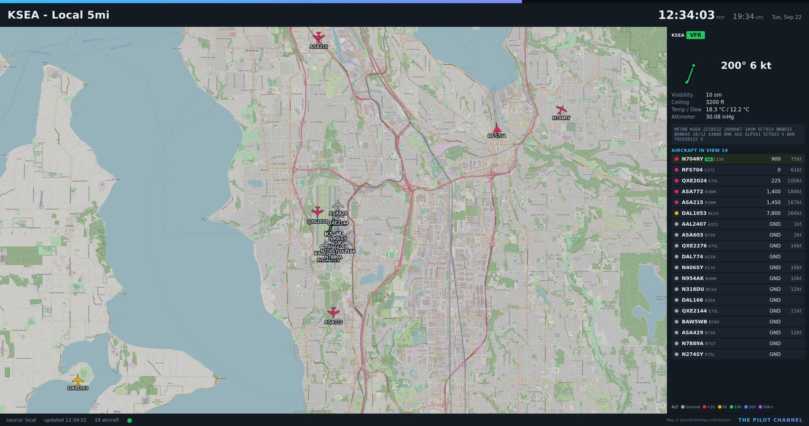
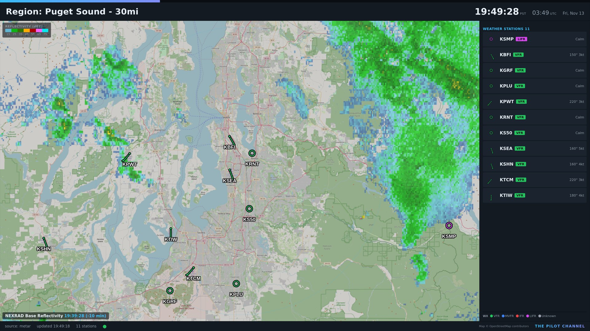
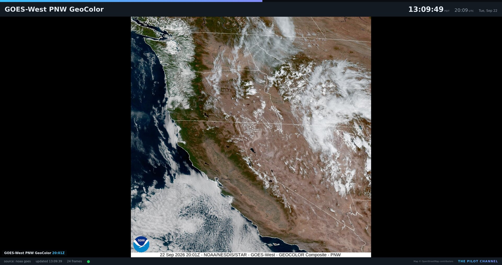
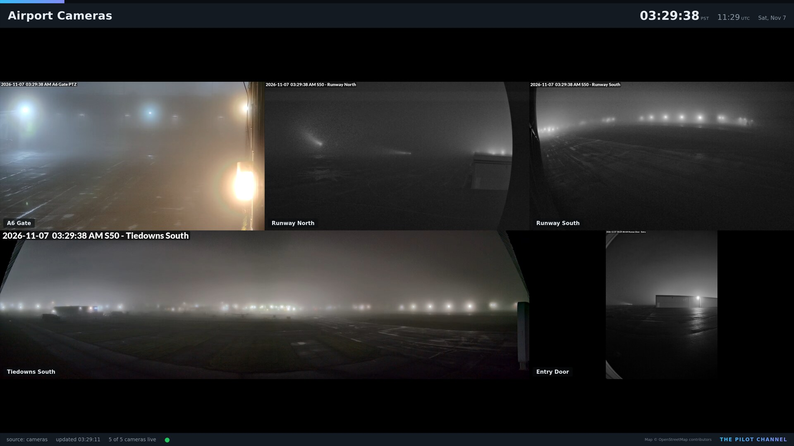
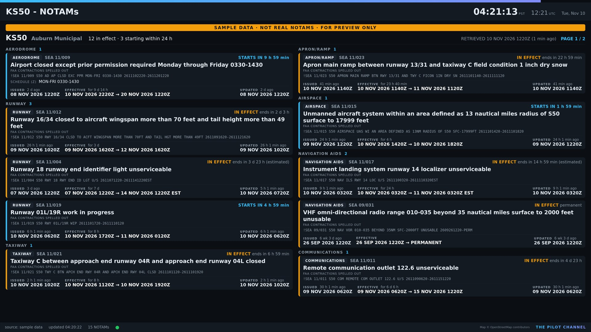
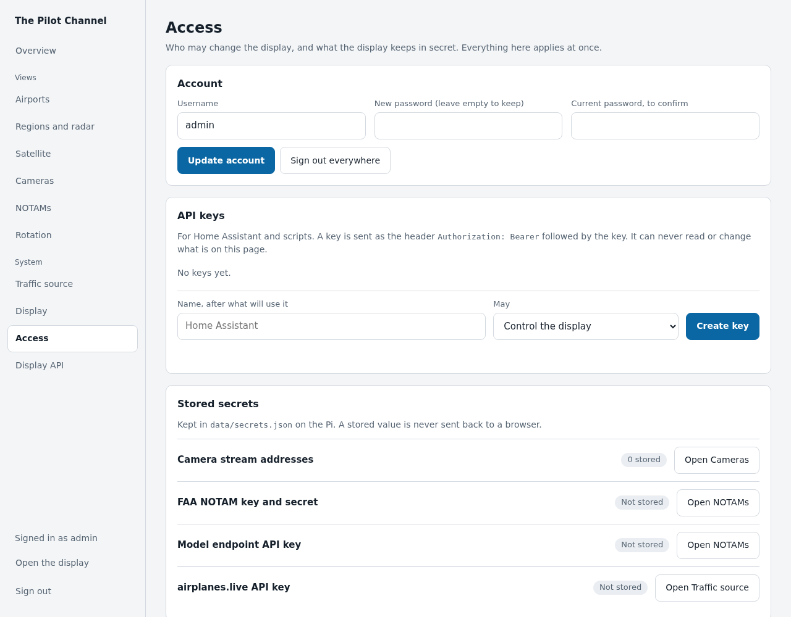

# The Pilot Channel

A wall-mounted information display for an airplane hangar. A Raspberry Pi drives an HDMI
TV that cycles through live air traffic around your airports, METAR weather, an animated
precipitation radar loop, a weather satellite loop, your security cameras, and the NOTAMs
for the airports you choose, with local and UTC clocks. You set it up from a phone or
laptop on the hangar network.

| | |
|---|---|
|  |  |
| **Local view:** live traffic, the airport's METAR and wind | **Regional view:** wind barbs over the radar loop |
|  |  |
| **Satellite loop:** animated NOAA GOES imagery | **Cameras:** live video from UniFi Protect cameras |
|  |  |
| **NOTAMs:** one view per location (here the built-in samples) | **Admin page:** the settings, here its Access page |

## Contents

- [What it shows](#what-it-shows) and [what you need](#what-you-need)
- [Install on the Raspberry Pi](#install-on-the-raspberry-pi)
- [Set up the display](#set-up-the-display), page by page
- [NOTAMs](#notams): FAA access, the settings, and how a NOTAM reads
- [Use the display from an automation](#use-the-display-from-an-automation): Home Assistant
  and other systems
- [Day to day](#day-to-day), [upgrading](#upgrading-from-an-older-version) and
  [troubleshooting](#troubleshooting)
- [The settings file](#the-settings-file)

## What it shows

The display cycles through its views on its own. A bar across the top drains to show the
time left on the current view.

- **Local view**, one per airport: a map centered on the airport with the aircraft around
  it, drawn with tar1090's aircraft icons, colored by altitude, turned to their track and
  labeled with their callsign or registration. Aircraft on the ground are included. The
  side panel shows the airport's METAR, decoded and raw, with a large wind barb, and every
  aircraft in view, general aviation first.
- **Regional view:** weather only. A wind barb for every airport reporting inside the map,
  colored by flight category (VFR green, MVFR blue, IFR red, LIFR magenta, gray when
  unknown), over an animated NEXRAD radar loop. The side panel lists the stations, worst
  conditions first.
- **Satellite loop** (optional): a full-screen NOAA GOES animation of your part of the
  country.
- **Cameras** (optional): live video on a grid you arrange. A panoramic camera gets a wide
  tile and a portrait camera a tall one. Built for UniFi Protect cameras on a Pi 5; other
  RTSP cameras that go2rtc can read work the same way.
- **NOTAMs** (optional): one view per location, with the NOTAMs in effect and those taking
  effect soon, each in plain language above the NOTAM as issued. See [NOTAMs](#notams).

Weather comes from the National Weather Service's Aviation Weather Center (and, for an
airport it does not list, from the Weather Service's own report files), radar from the Iowa
Environmental Mesonet, satellite images from NOAA STAR, and map tiles from OpenStreetMap.
Traffic comes from your own ADS-B receiver if you have one, or from a free public feed
(adsb.fi, adsb.lol or airplanes.live). None of these needs an account. Only the NOTAM views
need keys: the FAA's, which it issues on request, and your own model server's if it asks
for one.

## What you need

- A Raspberry Pi 5 or Pi 4 with 4 GB of memory, a microSD card of 8 GB or more, a power
  supply, and an HDMI cable to the TV (use the HDMI0 port). The camera view needs a Pi 5,
  for its hardware video decoder.
- Raspberry Pi OS Lite, 64-bit (the current release, based on Debian 13).
- A network connection, wired or Wi-Fi, with access to the internet.
- A phone or laptop on the same network for the setup.
- Optional: your own ADS-B receiver (tar1090, readsb or dump1090) for local traffic without
  rate limits.
- Optional: cameras with RTSP streams, for example UniFi Protect cameras with RTSP turned
  on.
- Optional: keys for the FAA NOTAM API and a language model server you run, for the NOTAM
  views (see [NOTAMs](#notams)).

## Install on the Raspberry Pi

One script turns a freshly flashed Pi into the kiosk. You can run it again at any time, and
`--check` reports what is and is not set up without changing anything.

1. **Flash the OS.** Use Raspberry Pi Imager to write Raspberry Pi OS Lite (64-bit). In the
   Imager settings (gear icon), set a hostname, enable SSH, create your user, and enter your
   Wi-Fi details if you are not using Ethernet.

2. **Boot the Pi and connect over SSH** (or plug in a keyboard) as the user you created.

3. **Run the bootstrap.** Give it a password of at least 8 characters for the admin
   account, so that the account exists before anyone else on your network can open the
   admin page. The account is called `admin` unless you add `--admin-user NAME`.

   ```bash
   curl -fsSL https://raw.githubusercontent.com/juchong/ThePilotChannel/main/deploy/bootstrap.sh \
     | bash -s -- --admin-password 'choose-a-password' --reboot
   ```

   It takes ten to twenty minutes, most of it the system update and the first build of the
   app. With `--reboot` the Pi restarts by itself when done; otherwise run `sudo reboot`.
   The TV shows a "The Pilot Channel" holding screen while the app starts, then the
   display.

4. **Check that it worked.** From your phone or laptop, open `http://<pi-ip>:8000/admin`
   (the bootstrap prints the address) and sign in. If you ran the bootstrap without
   `--admin-password`, the page asks you to create the account instead: do it right away,
   since the first person to open the page gets to. On the Pi,
   `~/ThePilotChannel/deploy/bootstrap.sh --check` should report every step as `[ok]`.

<details>
<summary><b>What the bootstrap changes on the Pi</b></summary>

Each step runs only if it is not already done:

- Updates the system (`apt-get full-upgrade`; skip it with `--no-upgrade`).
- Installs the kiosk browser and its compositor (`chromium`, `cage`, `wlrctl`, `seatd`),
  `grim` and ImageMagick for screenshots, `git`, `curl`, and the two packages rootless
  Docker needs (`uidmap`, `dbus-user-session`). The browser is Raspberry Pi's own build of
  Chromium; on a Pi 4 it updates with the OS.
- On a Pi 5, replaces that Chromium with the same version patched for the Pi's hardware
  H.265 decoder (the [chromium-rpi-hevc](https://github.com/sslivins/chromium-rpi-hevc)
  build, checked against its published checksums) and holds the packages so OS updates
  keep it. Only the camera view needs it.
- Clones this repository to `~/ThePilotChannel` (or uses the clone it is run from).
- Installs a small wrapper so `grim` can also write `jpeg`, `webp`, `avif` and `gif`
  screenshots (Debian's build writes only `png`); `sudo rm /usr/local/bin/grim` goes back
  to the stock one.
- Protects the Wi-Fi settings from power cuts (`deploy/harden-wifi.sh`). Raspberry Pi OS
  rewrites the Wi-Fi details from Imager at every boot, and a power cut during boot can
  leave them empty. The bootstrap moves them into a regular NetworkManager profile with a
  read-only backup and stops cloud-init from restoring the old files.
- Installs Docker with Docker's own installer and switches it to rootless mode: the daemon
  runs as your user, starts at boot without a login (after the network's DNS is up), and
  the root daemon is disabled.
- Enables the GPU overlay the kiosk needs (`dtoverlay=vc4-kms-v3d`, `max_framebuffers=2`),
  enables `seatd`, and puts your user in the `video`, `render` and `input` groups so the
  kiosk can drive the HDMI output.
- Logs in automatically on the TV console (tty1) and starts the kiosk there, and only there
  (not over SSH).
- Turns Wi-Fi power saving off, which otherwise drops connections on an unattended Pi.
- Keeps the system log across reboots, capped at 64 MB (`journalctl -b -1` shows the
  previous boot).
- Builds the app and starts it, waiting until it answers.
- Creates the admin account if you gave a password and there is none yet. The password goes
  straight to the app, which keeps only a hash of it.

Options: `--check`, `--dry-run`, `--no-upgrade`, `--no-start`, `--reboot`,
`--admin-password PW`, `--admin-user NAME`, `--repo-dir DIR`; `--help` lists them.

The kiosk browser runs on the Pi itself (cage and Chromium), not in Docker, because it
needs the GPU and the HDMI output. It keeps its profile, cache and log on a RAM disk
(`/dev/shm/hangar-kiosk`) to spare the SD card.

</details>

### Try it without a Pi

The app runs on any 64-bit Linux machine with Docker, and you can look at it in a browser.
This is handy for setting up your airports before the Pi is ready.

```bash
curl -fsSL https://get.docker.com | sudo sh
sudo usermod -aG docker "$USER"   # log out and back in afterwards
git clone https://github.com/juchong/ThePilotChannel.git
cd ThePilotChannel
docker compose up -d --build
```

Then open `http://<host-ip>:8000` for the display and `http://<host-ip>:8000/admin` for the
settings. The first visit to the admin page creates its account.

## Set up the display

Open `http://<pi-ip>:8000/admin` and sign in. The menu on the left (behind a Menu button on
a phone) lists the pages.

- **Overview** shows what is on the TV, lets you step through the views or black out the
  picture, and says whether each data feed is healthy.
- The pages under **Views** and **System** hold the settings. Change what you like, then
  press **Save and reload display** in the bar that appears at the bottom; the TV reloads
  with the new settings. A mistake is marked on its field, and its page in the menu.
  **Discard** drops your changes.
- Camera addresses, keys and the account are different: they take effect as soon as you
  store them, and never reload the TV.

A new display has no airports yet and shows only the satellite loop until you add some.

### Airports

One row per airport you want a local view for:

- **Identifier:** the one its weather reports carry. That is the ICAO identifier (`KSEA`),
  or for a US field without one, `K` followed by the FAA identifier (`KS50`).
- **Name**, the **latitude and longitude** of the field, and the **radius** in miles of its
  map (5 is typical).

The arrows set the order of the views. An airport without a weather station shows "no
weather" on its local view, and still shows traffic. An airport the Aviation Weather Center
does not list, such as one whose AWOS is new, is read from the Weather Service's report
files instead; the Overview page names the airports read this way.

A station's flight category is shown only when its report settles it. When the sky
condition or the visibility is missing, the category is unknown, unless what is reported
decides it alone (a visibility below one mile is LIFR whatever the ceiling); for an airport
read from the Weather Service's files, a cloud layer reported without its height counts as
missing too. A station of unknown category is drawn in gray and labeled UNKNOWN: its wind
barb, or a gray circle when the report has no wind. The ceiling is read from the report
itself, so a cloud layer reported without its height leaves the ceiling unknown.

### Regions and radar

A region is a wider weather view: a center point and a radius. Wind barbs appear for every
airport reporting weather inside the map, not just yours. One region is usually enough;
with more, they take turns between the local views.

The radar loop plays on the regional view. Ten frames five minutes apart make a 45-minute
loop; the loop reaches back at most 55 minutes. The opacity slider sets how strongly the
radar shows over the map. **Hide returns below** leaves out weak returns, which below
about 10 dBZ are mostly not precipitation; 0 draws everything. Frames step every half
second, and **Cross-fade frames** dissolves them into each other instead (off by default:
the fade is expensive on a Pi 4).

### Satellite

Choose the satellite (G16 is GOES-East, G18 is GOES-West), the sector and the band. The
sector code is in the address of your region's page on the NOAA STAR GOES image viewer, for
example `pnw` (Pacific Northwest), `psw` (Pacific Southwest), `nr` (Northern Rockies), `sr`
(Southern Rockies), `sp` (Southern Plains), `umv` (Upper Mississippi Valley), `cgl` (Central
Great Lakes), `ne` (Northeast) or `se` (Southeast). `GEOCOLOR` is the natural-color band
most people want, and `1200x1200` frames suit a 1080p TV.

### Cameras

**Streams** are your cameras. For each one, give it a name, paste its RTSP or RTSPS link,
and press **Add stream**.

- For UniFi Protect, the link is on the camera's settings page in the Protect app, under
  Advanced, in the RTSP section: turn on a quality and copy its link. Use the medium
  quality: a tile is at most 1280 pixels wide on a 4K TV, and several full-resolution
  streams are more than the Pi's decoder is rated for. The `?enableSrtp` that Protect
  appends is removed, because the relay does not decrypt SRTP and the link is already
  carried inside TLS without it.
- **Test** has the relay open the camera and says what video it sends.
- A link carries an access token, so it is kept in the display's secrets store and never
  shown again: the page lists a stream by its name and the host of its address. To change
  an address, use **Rename or replace address** on its row; its tiles switch within
  seconds. Nothing needs restarting.

**Layout on the TV** arranges the tiles: the stream each one plays, an optional caption,
and how many of the six grid columns it spans. Every row is as tall as a 16:9 tile of two
columns, so two columns suit a normal camera and four a panoramic one; a portrait camera is
centered in its tile. Tiles fill the rows in order, and the page draws the grid as the TV
will show it. The Overview page says whether the relay is up and names any tile without a
stream.

### Traffic source

Where aircraft positions come from:

- **A public feed:** adsb.fi, adsb.lol or airplanes.live, free of charge. Coverage depends
  on volunteers' receivers near your airport; positions arrive about once a second. An
  airplanes.live API key, if you have one, is stored on the same page.
- **The local receiver:** your own tar1090, readsb or dump1090. Enter the address of its
  `aircraft.json`, for example `http://192.168.1.20:8080/data/aircraft.json`. Use the
  receiver's network address even if it runs on the Pi itself: the app runs in a container,
  where `localhost` means the container.
- **The local receiver, else a public feed:** the receiver, and the feed while the receiver
  cannot be reached.

**Test connection** checks the source before you save, and reports how many aircraft each
source sees near your first airport.

### Rotation

How long each local and regional view stays on screen, how many local views one cycle
shows, and whether a regional view goes between local views. The page lists the rotation as
it is saved. The other views set their own time on their pages.

### Display

Your time zone (an IANA name such as `America/Denver`) for the clock, how often the weather
reports refresh, and when a report counts as stale. The map uses OpenStreetMap tiles; the
Pi keeps a copy of every tile your views need in `data/tiles` (refreshed every two weeks)
and fetches them for new airports and regions in the background after you save, so views
switch without the map redrawing. If you have your own tile server, or a vector style URL
from a map provider, enter it here.

### Access

Your account (username, a new password, signing out every browser), the API keys for
automations (see [Use the display from an automation](#use-the-display-from-an-automation)),
and a list of what the display keeps secret and where to change it. Passwords, keys and
camera links are stored on the Pi in `data/secrets.json`, readable only by the display;
passwords and API keys only as hashes, so even that file does not reveal them.

## NOTAMs

A NOTAM view shows the NOTAMs that affect one location: those in effect now and those
taking effect within the hours you choose, grouped by type (aerodrome, runway, taxiway,
apron, airspace, navigation aids, communications, services, instrument procedures, and
obstructions last). NOTAMs are chosen by the location they affect, not by the office that
issued them: a closure at a small field is often issued under a larger airport's
accountability and still appears under the small field.

Each NOTAM card shows:

- a plain-language line (see [How a NOTAM reads](#how-a-notam-reads));
- the NOTAM as issued, which is the one that counts;
- when it was issued, when it takes effect and ends, how long it runs, and when it was last
  updated.

Times are in the display's time zone (Display page), with the zone's name for that date
(PST, PDT); the NOTAM as issued keeps its UTC times. A time in a NOTAM's wording, such as a
daily closure, is converted where that is exact and marked UTC where it is not (when
daylight saving time changes within the NOTAM, or a named day or date would move); wording
that already gives local times is left as written. A location with more NOTAMs than fit on
the screen is shown a page at a time.

### Getting access from the FAA

The NOTAMs come from the FAA NOTAM Management Service (NMS) API. Access is free but not
self-serve:

1. Email NOTAMS@faa.gov (the address behind "API Access" on
   [nms.aim.faa.gov](https://nms.aim.faa.gov/)), ask for access to the NMS-API, and say what
   you will use it for.
2. The FAA first issues keys for its **test environment** (staging): a client ID, which it
   calls KEY, and a client secret, SECRET. On the NOTAMs page, choose the environment
   **Staging**, enter both and press **Store keys**. **Check keys** asks the FAA for a token
   with them and costs no data pull. While a test environment is selected, every NOTAM view
   carries a banner: its NOTAMs may be test data and are not for operational use.
3. Let the display run against staging. The page's *Requests to the FAA* card counts the
   requests of the last 24 hours, the shortest interval between two data pulls, and any the
   FAA refused; **Download the record** saves every request with the id the FAA gave it.
   When you are satisfied, ask the NOTAM Service Center (7-AWA-NAIMES@faa.gov,
   866-466-1336) for production keys, and send the record along if they want to see how
   your display uses the service.
4. With production keys, choose the environment **Production**, store the keys, and save.
   Keys belong to the environment they were stored under and are only ever sent to it.

The FAA allows one data pull every three minutes, and the display never asks more often, in
either environment. It fetches each location's NOTAMs once, then asks every three minutes
for everything that changed, and fetches each location whole again every six hours. A new
location and **Refresh now** wait for the next turn; the page says how long that is.

### The NOTAMs page

- **Locations.** Type one or more identifiers into the box and press Enter, or click one of
  your airports offered under the list. A location is the identifier of the affected
  facility: an airport (`S50` or `KS50`, `KSEA`), a NAVAID, or an air route traffic control
  center (`ZSE`). The FAA files airspace activity more than 5 miles from an airport under
  the nearest VOR or the center, so add those if you want them. Each row says how many
  NOTAMs are held for the location and through what time they are complete. The optional
  name appears in the view's heading.
- **Include NOTAMs starting within.** NOTAMs in effect are always shown; this adds those
  that take effect within this many hours. 0 shows only those in effect.
- **Each page stays up.** How long each page of a location stays up. A location whose
  NOTAMs fill three pages stays up three times as long.
- **Look for changes every.** How often the display asks the FAA for changes: 180 seconds at
  the least. The display keeps the NOTAMs it holds, also across restarts, and the view's
  heading says when they were retrieved.
- **NOTAMs come from.** The FAA, live; or sample data, invented NOTAMs under a banner that
  says so, for seeing the view before your keys arrive. The two are never mixed.

Live NOTAM views are shown only with the model rewrite turned on (see
[Rewriting NOTAMs with your own model](#rewriting-notams-with-your-own-model)). The footer
of every NOTAM view names its source as "FAA NMS Processed with *your model* LLM", so
nobody takes the plain-language lines for the FAA's own words; the page shows the exact
text.

### How a NOTAM reads

The plain-language line spells out the contractions the FAA defines for NOTAMs (the NOTAM
tables of the Aeronautical Information Manual, FAA Order 7930.2 and FAA Order JO 7340.2)
and ICAO's (Doc 8400, which NOTAMs from other countries use). Units are written out after a
number (feet, nautical miles, metres, kilograms, megahertz). A NOTAM is all capitals, so
ordinary words are put in lower case: "DO NOT USE FALSE INDICATIONS POSSIBLE" reads "do not
use false indications possible".

Anything that cannot be read safely stays as written: designators, numbers and place
identifiers ("RADIUS OF SAT" is San Antonio, not Saturday), contractions with two meanings,
groups that are also plain words (IF, PER), names, the phonetic alphabet (taxiway BRAVO),
and words that may be the name of a fix in a procedure or route NOTAM. Since capitals do
not tell a name from a word, a name that is also an ordinary word reads in lower case
("drum military operations area" for the DRUM MOA). Where a contraction stands for several
forms of one word (ACT is active, activated or activity), the line uses the form the FAA
writes most often, which can be the wrong part of speech ("bird active increased").

The NOTAM as issued is always beneath the line, and it is the one that counts. This display
is an aid in the hangar, not a preflight briefing.

Also on the cards:

- When the times in the FAA's data differ from the times written in the NOTAM, the card
  says so in red; the NOTAM text is the one to read.
- At larger airports the FAA issues most NOTAMs twice: in the domestic format, and in ICAO
  form in its international series. A view shows such a NOTAM once, leaving out the
  international one only when its text, start and end are exactly those of a domestic NOTAM
  on the same view.
- The NMS is not the authoritative source for NOTAMs issued by other countries, and a view
  that holds such NOTAMs says so.

### Rewriting NOTAMs with your own model

A language model you host can turn the plain-language line into a sentence, for example
"Taxiway C between the approach end of runway 04R and the approach end of runway 04L is
closed". It needs a server with an OpenAI-compatible API, such as LiteLLM or vLLM; nothing
is sent anywhere else. Live NOTAM views need it; sample views work without it. In the
*Model rewrite and source label* card of the NOTAMs page:

- **Rewrite NOTAMs with the model** turns it on.
- **Model, as named on the TV** is what the footer calls the model, for example
  `Qwen 3.8 27B`.
- **Endpoint** is the server's URL, ending in `/v1`, and **Model name at the endpoint** the
  name the server knows the model by.
- **Wait for an answer at most** limits how long one answer may take.
- **Endpoint API key** is the server's key, if it wants one. **Store key** keeps it in the
  display's secrets store; it is never shown again.
- **Test model** sends one FAA example NOTAM to the model and shows the answer, whether it
  passed the check, and how long it took. It also fills in the model names the server
  offers. Nothing is saved.

A program checks every answer before it is shown. Every number, designator, identifier and
word of the NOTAM must be in the answer, in the NOTAM's order and written as in the NOTAM.
The model may add only a few joining words (a, an, the, is, are, and, of, at, with, that,
which, there, it, its, this, and "to" after DUE) and punctuation that cannot change how a
number reads, and must end a statement where the NOTAM does. An answer that fails goes back
to the model once, with what was wrong; if the second one fails too, the spelled-out line
stays. The check cannot tell whether a joining word links two parts of the NOTAM the way
the NOTAM means, so each card says which line it shows ("Model rewrite, checked against the
NOTAM" or "FAA contractions spelled out"), and the NOTAM as issued is beneath it either way.

Each NOTAM is rewritten once and the checked answer is kept, also across restarts. The view
never waits for the model: a NOTAM shows the spelled-out line until its rewrite has passed,
and keeps it while the model server is down. The NOTAMs page counts the rewrites shown,
refused and waiting.

To measure a model before relying on it, `backend/tools/eval_notam_model.py` sends it the
FAA's example NOTAMs (or a file of your own) and reports how many answers passed, every
refused answer with the reason, and the accepted answers beside the spelled-out line. It
uses the endpoint key stored on the admin page:

```bash
docker run --rm -v "$PWD/data:/data" -v "$PWD/backend:/work:ro" -w /work hangar-display:latest \
  python tools/eval_notam_model.py --base-url https://llm.example.net/v1 --model NAME
```

With `--network container:hangar-display` and `--display http://localhost:8000` added, it
uses the NOTAMs your display shows for your own locations instead. `--jobs 4` keeps four
NOTAMs with the model at a time, and `--out FILE` saves every answer.

## Use the display from an automation

Home Assistant, or any other system on your network, can step the display through its
views, jump to a view, black out the picture, and read the weather at your airports and on
your regional maps. (The admin page's Overview has buttons for the display controls.)

**API keys.** An automation identifies itself with an API key. Create one on the admin
page under **Access**, API keys: name it after what will use it, and choose what it may do
(control the display, or also change settings). The key is shown once, so copy it then;
the page keeps only enough of it to tell keys apart, and **Revoke** ends it. Send it in
the `Authorization` header as `Bearer` followed by the key. The admin password is not
accepted for these calls.

**The full reference.** The admin page's **Display API** page describes every call: what it
takes and answers, its errors and limits, the event stream that reports changes, and the
ids of your display's views, with your display's address filled in. **Copy as Markdown**
puts it on the clipboard, ready to paste into an AI agent or a project that will make the
calls; **Download** saves it as `display-api.md`. It never contains a key. The same
reference, with `<pi-ip>` in place of the address, is
[backend/app/data/display_api.md](backend/app/data/display_api.md).

**Home Assistant** reads the key from `secrets.yaml`. Put the header's whole value there:
the word `Bearer`, a space, and the key.

```yaml
hangar_display_key: "Bearer tpc_your-key"
```

### Change the view

The display keeps cycling on its own. These calls move it on, back, or straight to a view,
which then stays up for its usual time before the cycle continues.

```bash
curl -X POST -H 'Authorization: Bearer tpc_your-key' http://<pi-ip>:8000/api/display/next
```

```bash
curl -X POST -H 'Authorization: Bearer tpc_your-key' http://<pi-ip>:8000/api/display/previous
```

```bash
# jump to a view by id; GET /api/views lists them (local:KSEA, region:Puget Sound, satellite, cameras, notams:KS50)
curl -X POST -H 'Authorization: Bearer tpc_your-key' -H 'content-type: application/json' \
  -d '{"view": "satellite"}' http://<pi-ip>:8000/api/display/view
```

`GET /api/display` reports what is on screen: `showing.label`, and its place in the cycle as
`showing.index` of `showing.count`. Reading it needs no key.

In Home Assistant's `configuration.yaml`: commands for the buttons and for jumping to a
view, and a sensor that shows the current view.

```yaml
rest_command:
  hangar_display_next:
    url: "http://<pi-ip>:8000/api/display/next"
    method: post
    headers:
      authorization: !secret hangar_display_key
  hangar_display_previous:
    url: "http://<pi-ip>:8000/api/display/previous"
    method: post
    headers:
      authorization: !secret hangar_display_key
  hangar_display_view:
    url: "http://<pi-ip>:8000/api/display/view"
    method: post
    content_type: "application/json"
    headers:
      authorization: !secret hangar_display_key
    payload: '{"view": "{{ view }}"}'

rest:
  - resource: "http://<pi-ip>:8000/api/display"
    scan_interval: 5
    sensor:
      - name: Hangar display view
        value_template: "{{ value_json.showing.label or 'unknown' }}"
```

A dashboard card with previous and next buttons around the current view:

```yaml
type: horizontal-stack
cards:
  - type: button
    name: Previous
    icon: mdi:skip-previous
    tap_action:
      action: perform-action
      perform_action: rest_command.hangar_display_previous
  - type: entity
    entity: sensor.hangar_display_view
    name: Showing
  - type: button
    name: Next
    icon: mdi:skip-next
    tap_action:
      action: perform-action
      perform_action: rest_command.hangar_display_next
```

To jump to a view from an automation or a script, pass its id:

```yaml
actions:
  - action: rest_command.hangar_display_view
    data:
      view: satellite
```

A dashboard button that brings up the cameras:

```yaml
type: button
name: Cameras
icon: mdi:cctv
tap_action:
  action: perform-action
  perform_action: rest_command.hangar_display_view
  data:
    view: cameras
```

### Black out the picture

The picture can be blacked out for a while and brought back, for example while a movie
plays or when the doorbell rings. The display keeps running underneath, so the picture
returns at once.

```bash
# black out for 30 seconds
curl -X POST -H 'Authorization: Bearer tpc_your-key' -H 'content-type: application/json' \
  -d '{"seconds": 30, "reason": "doorbell"}' http://<pi-ip>:8000/api/display/blackout
```

```bash
# black out until told otherwise, then restore
curl -X POST -H 'Authorization: Bearer tpc_your-key' http://<pi-ip>:8000/api/display/blackout
curl -X POST -H 'Authorization: Bearer tpc_your-key' http://<pi-ip>:8000/api/display/restore
```

In Home Assistant's `configuration.yaml`:

```yaml
rest_command:
  hangar_display_blackout:
    url: "http://<pi-ip>:8000/api/display/blackout"
    method: post
    content_type: "application/json"
    headers:
      authorization: !secret hangar_display_key
    payload: '{"seconds": {{ seconds | default(30) }}, "reason": "{{ reason | default("home assistant") }}"}'
  hangar_display_restore:
    url: "http://<pi-ip>:8000/api/display/restore"
    method: post
    headers:
      authorization: !secret hangar_display_key
```

Then in an automation:

```yaml
actions:
  - action: rest_command.hangar_display_blackout
    data:
      seconds: 20
      reason: doorbell
```

### Read the weather

`GET /api/conditions` gives the latest report the display holds for each of your airports
and for every station on your regional maps: the flight category, ceiling, visibility, wind
direction, speed and gusts, temperature, dew point, relative humidity and altimeter
setting, with the report itself. It needs an API key; either kind works.

```bash
curl -H 'Authorization: Bearer tpc_your-key' http://<pi-ip>:8000/api/conditions
```

- `monitored` lists your airports in the order of your settings.
- `regions` lists, for each region, the stations on its map as the TV shows it.
- `airports` gives the values of every one of them by identifier: your airports first,
  then the other stations in alphabetical order.

A value the report does not give is `null`, and `category` is `UNKNOWN` when the report
does not settle one. `ceiling_ft` is `null` both when there is no ceiling and when its
height is not known; `ceiling_known` tells the two apart. The display refreshes its reports
as often as the Display page says (every 5 minutes by default), so polling more often gains
nothing. A region's map is the rectangle the TV shows, so until the TV has shown a region
(after you add it or change its center or radius), the area around its circle is used.

In Home Assistant's `configuration.yaml`, one sensor per value you want, here for KBFI
(repeat them for each airport). The category sensor carries the other values as
attributes.

```yaml
rest:
  - resource: "http://<pi-ip>:8000/api/conditions"
    scan_interval: 300
    headers:
      authorization: !secret hangar_display_key
    sensor:
      - name: KBFI flight category
        value_template: "{{ value_json.airports.KBFI.category }}"
        json_attributes_path: "$.airports.KBFI"
        json_attributes:
          - ceiling_ft
          - ceiling_known
          - visibility_sm
          - wind_dir_deg
          - wind_gust_kt
          - observed
          - stale
          - raw
      - name: KBFI temperature
        value_template: "{{ value_json.airports.KBFI.temperature_c }}"
        availability: "{{ value_json.airports.KBFI.temperature_c is not none }}"
        unit_of_measurement: "°C"
        device_class: temperature
      - name: KBFI humidity
        value_template: "{{ value_json.airports.KBFI.humidity_pct }}"
        availability: "{{ value_json.airports.KBFI.humidity_pct is not none }}"
        unit_of_measurement: "%"
        device_class: humidity
      - name: KBFI wind speed
        value_template: "{{ value_json.airports.KBFI.wind_speed_kt }}"
        availability: "{{ value_json.airports.KBFI.wind_speed_kt is not none }}"
        unit_of_measurement: "kn"
        device_class: wind_speed
```

An automation that reacts when the field goes IFR or worse:

```yaml
triggers:
  - trigger: state
    entity_id: sensor.kbfi_flight_category
    to: ["IFR", "LIFR"]
actions:
  - action: persistent_notification.create
    data:
      message: "KBFI is {{ trigger.to_state.state }}"
```

## Day to day

- **Change settings:** on the admin page. The TV reloads itself when you save.
- **Update to a new version:**

  ```bash
  cd ThePilotChannel && git pull && docker compose up -d --build
  ```

  The display notices the new version and reloads on its own.
- **Update the OS:** `sudo apt full-upgrade` and reboot, or run the bootstrap again (it
  upgrades the system and re-checks every other step). On a Pi 4 the kiosk browser updates
  with the OS. On a Pi 5 it is held at the patched build; to take a newer patched release,
  change the release named in `deploy/bootstrap.sh` and run it again.
- **Add or change a camera:** on the Cameras page. A new address is live within seconds.
- **Forgot the admin password:** on the Pi, in the clone, run
  `docker compose exec app python -m app.access set-password` and type a new one. It signs
  out every browser.
- **Restart the display browser:** `pkill -x cage`. It comes straight back.
- **Reboot the Pi:** everything starts again by itself, also after a power cut.
- **Undo a bad settings change:** copy `data/config.yaml.bak.1` over `data/config.yaml` and
  run `docker compose restart`.
- **Map looks out of date:** delete the `data/tiles` folder; it is rebuilt by itself.
- **Logs:** `docker compose logs -f` for the app (capped so it cannot fill the SD card),
  `docker compose logs go2rtc` for the camera relay, and
  `/dev/shm/hangar-kiosk/hangar-kiosk.log` for the kiosk browser.
- **Change the Wi-Fi network or password:** use `sudo nmtui` (Edit a connection), then run
  `sudo ~/ThePilotChannel/deploy/harden-wifi.sh`, which moves the edited profile back out of
  netplan and refreshes the backup copy. To forget a network, delete it in `nmtui` and
  remove its `hardened-<uuid>.nmconnection` file from
  `/usr/lib/NetworkManager/system-connections`.
- **Move to a new Pi:** everything you set up is in two files in the clone's `data/` folder,
  which git leaves alone: `config.yaml` (the settings) and `secrets.json` (the account, the
  API keys, the camera links and the other keys; keep it private). Copy both off the old Pi.
  Flash and bootstrap the new Pi as in the install steps, put both files back in `data/`,
  and run `docker compose up -d`. The tile and weather caches rebuild on their own. The new
  Pi may get a different address: update any automation that points at it.

## Upgrading from an older version

Update as usual (`git pull && docker compose up -d --build`), with these extra steps if
they apply:

- **Your version kept passwords and camera links in `.env`.** At its first start, the new
  version copies what `.env` holds (the admin password, as the password of the account
  `admin`; the camera links; the FAA keys; the model key) into `data/secrets.json`, and
  does not read `.env` again. The Access page lists the lines still there: delete them, or
  the file, and run `docker compose up -d`. Home Assistant and scripts that sent the admin
  password need an API key instead (see
  [Use the display from an automation](#use-the-display-from-an-automation)).
- **Your repository held `data/config.yaml`.** `git pull` refuses to replace your settings
  file. Set it aside for the update and put it back afterwards:

  ```bash
  cd ThePilotChannel && cp data/config.yaml ~/config.yaml.keep && git checkout -- data/config.yaml
  git pull && cp ~/config.yaml.keep data/config.yaml && docker compose up -d --build
  ```

## Troubleshooting

`http://<pi-ip>:8000/api/status` reports the state of every feed, and
`docker compose logs` the errors behind it.

### The Pi and the network

- **The Pi does not come back on Wi-Fi after a power cut.** Plug in a network cable
  (Ethernet needs no saved settings) or a keyboard, then run
  `sudo ~/ThePilotChannel/deploy/harden-wifi.sh`. It recreates the Wi-Fi profile from the
  details you entered in Imager (kept in `/boot/firmware/network-config`) and removes the
  emptied files in `/etc/netplan`. `deploy/harden-wifi.sh --check` shows whether a Pi is
  protected. The cause is a
  [Raspberry Pi OS issue](https://github.com/raspberrypi/trixie-feedback/issues/99).
- **Every view waits for data after a reboot, and the weather is missing.** The app started
  before the Wi-Fi had a DNS server, and cannot resolve names; `/api/status` shows
  "Temporary failure in name resolution". Run `systemctl --user restart docker` and it
  recovers at once. The bootstrap makes Docker wait for DNS at boot;
  `deploy/bootstrap.sh --check` confirms that is in place.
- **`docker` commands fail or say the daemon is not running.** Docker runs in rootless mode
  as your user: run `docker` commands as that user, without `sudo`, and check
  `systemctl --user status docker`. `deploy/bootstrap.sh --check` reports what is wrong.

### The TV

- **The TV stays black or shows only the holding screen.** The app is not up yet or failed
  to start: run `docker compose ps` and `docker compose logs --tail=50` on the Pi. If the
  kiosk never appears at all, check `/dev/shm/hangar-kiosk/hangar-kiosk.log`, confirm
  `dtoverlay=vc4-kms-v3d` is in `/boot/firmware/config.txt`, and make sure you rebooted
  after the bootstrap.
- **`Unable to create the wlroots backend` in the kiosk log.** The kiosk must start from the
  TV console (tty1) with no `WAYLAND_DISPLAY` in its environment. Do not export
  `WAYLAND_DISPLAY` in your login shell.
- **The footer dot is amber or red.** Amber means the last traffic snapshot is more than ten
  seconds old; red means the source is failing. Hover over the dot in a browser, or check
  `/api/status`, for the reason.
- **Map tiles do not load.** The Pi cannot reach OpenStreetMap. Tiles already in
  `data/tiles` keep working meanwhile. Check the connection, or point the tile address
  (Display page) at your own tile server.

### Traffic and weather

- **No aircraft.** Press **Test connection** on the Traffic source page, or open
  `/api/status`. For a local receiver, the address must be its network address, not
  `localhost`.
- **No weather or wind barbs.** Check that the Pi can reach `aviationweather.gov`, and that
  the identifier is the one the station reports under (`KS50`, not `S50`); some small
  fields have no weather station. An airport aviationweather.gov does not list is read from
  `tgftp.nws.noaa.gov`, so a newly installed AWOS shows up once its reports are on either.
  The display keeps the last weather it fetched, also across restarts, and turns the footer
  dot amber when it is getting old and red when refreshes fail. A name-resolution error in
  the log means the router's DNS is not answering.
- **A dash in place of a value.** The report did not give it. For the ceiling, a dash also
  means there is no ceiling.

### Cameras

- **A tile says NO SIGNAL.** The relay is not getting that stream. **Test** on the Cameras
  page says whether the camera answers and why not; the Overview page says whether the relay
  is up and names tiles without a stream; `docker compose logs go2rtc` shows the relay's
  side. The camera's RTSP output must be turned on.
- **Video is choppy, or the tiles stay black on a Pi 4.** The camera view needs the Pi 5's
  hardware decoder. On a Pi 5, `deploy/bootstrap.sh --check` confirms that the patched
  browser is installed and held.

### NOTAMs

- **There is no NOTAM view although the views are on.** Live NOTAM views are held back until
  the model rewrite is on and the model has a name for the TV; the NOTAMs page says so at
  its top.
- **A NOTAM view says the data is unavailable, or NOT REFRESHING.** The reason is on the
  view when nothing was ever fetched, on the Overview and NOTAMs pages, and in
  `docker compose logs`. While refreshes fail, the view keeps the last NOTAMs it holds,
  with the time they were retrieved.
  - "No FAA credentials are stored for the ... environment": no keys were stored, or they
    were stored for another environment than the one selected.
  - "rejected the credentials": the FAA did not accept the keys. The display waits half an
    hour, or until you store keys again, before asking once more.
  - "is limiting requests": the FAA said it was asked too often; the display waits longer
    before its next pull.
  - "reported a failure": the FAA answered that the request failed, and gave its reason.
  - "does not know location": the identifier is not one the FAA files NOTAMs under.
- **NOTAM cards never say "Model rewrite".** The NOTAMs page counts the rewrites shown,
  refused and waiting, and gives the reason when the model server cannot be used: no
  endpoint key stored, a key the server rejects, a model name it does not know, or no answer
  within the time allowed. **Test model** shows the same for one NOTAM. Many refused answers
  mean the model does not follow its instructions; the cards then keep the spelled-out
  line, as intended.

### The admin page and automations

- **A red banner about `config.yaml`.** The file could not be read, and the display is
  running with a backup or the defaults. Fix the file by hand, or save from the admin page
  to write a fresh one (the broken file is kept as `config.yaml.bak.1`).
- **The admin page says the secrets store cannot be read.** `data/secrets.json` and its
  backup are damaged. The display keeps running, but nobody can sign in. Restore the file
  from a copy, or delete `data/secrets.json` and `data/secrets.json.bak` and create the
  account again (camera links and keys then have to be entered again too).
- **Signing in says to wait.** After several wrong passwords the page refuses further tries
  for a while, longer each time. Wait, or set a new password on the Pi (see
  [Day to day](#day-to-day)).
- **An automation gets 401 or 403.** 401: the key is missing, mistyped or revoked, or the
  call still sends the admin password. 403: the key may only control the display and the
  call changes settings; create a key that may do both.

## The settings file

Every setting of the Views and System pages lives in `data/config.yaml` on the Pi; nothing
secret is in it (addresses, keys and the account are in `data/secrets.json`). The display
writes it with the defaults at its first start. Like everything in `data/`, it is yours and
not part of the repository.

You can edit it by hand and run `docker compose restart` to apply it. Each save keeps the
previous three versions as `config.yaml.bak.1` to `.3`. If the file cannot be read, the
display still starts with the newest good backup, and the admin page shows a banner that
says what is wrong.

Every setting, with its default or an example:

```yaml
airports:
  - icao: KSEA
    name: Seattle-Tacoma Intl
    lat: 47.4502
    lon: -122.3088
    local_radius_mi: 5.0
    enabled: true

regions:
  - name: Puget Sound
    center_lat: 47.44
    center_lon: -122.27
    radius_mi: 30.0
    enabled: true

cycle:
  local_dwell_s: 20          # seconds on each local view
  regional_dwell_s: 15       # seconds on each regional view
  order: []                  # optional explicit order of view ids
  max_local_views: 0         # 0 means show every enabled airport
  interleave_regional: true  # put a regional view between local views

data_source:
  mode: auto                 # local | aggregator | auto
  local_url: http://192.168.1.20:8080/data/aircraft.json
  aggregator: adsbfi         # adsbfi | adsblol | airplaneslive
  drop_timeout_s: 15         # remove an aircraft whose position is older than this

display:
  timezone: America/Los_Angeles
  basemap: raster_osm        # raster_osm | vector
  tile_url: ""               # vector style URL, or a raster tile template override

weather:
  refresh_s: 300
  stale_after_s: 4500

satellite:
  enabled: true
  sat: G18                   # G16 (East), G18 (West), G19
  sector: pnw
  band: GEOCOLOR
  frames: 24
  size: 1200x1200            # 300x300 | 600x600 | 1200x1200 | 2400x2400
  dwell_s: 25
  label: GOES-West PNW GeoColor

radar:
  enabled: true
  label: NEXRAD Base Reflectivity
  frames: 10
  interval_min: 5            # multiple of 5; (frames - 1) x interval must be 55 or less
  opacity: 0.75              # 0 (invisible) to 1 (solid)
  min_dbz: 10                # hide returns weaker than this (dBZ)
  product: n0q               # n0q (base reflectivity) | n0r
  crossfade: false           # dissolve between frames (expensive on a Pi 4)

cameras:
  enabled: false
  label: Cameras
  dwell_s: 30
  tiles:
    - name: Gate             # caption; the stream's name when empty
      stream: cam1           # the id of a stream stored on the Cameras page (cam1 to cam12)
      cols: 2                # of 6 grid columns: 2 is a 16:9 tile, 4 a 32:9 tile

notams:
  enabled: false
  source: faa                # faa (needs the FAA keys and the rewrite below) | sample
  environment: production    # production | staging | fit: the NMS-API environment of the keys
  label: NOTAMs
  dwell_s: 30                # seconds per page
  lookahead_h: 24            # also show NOTAMs taking effect within this many hours
  refresh_s: 180             # look for changes this often; the FAA allows one pull per 180 s
  locations:                 # the affected facility: airport, NAVAID or ARTCC identifier
    - ident: KS50            # S50 and KS50 are the same location
      name: Auburn Muni      # shown in the view's heading
      enabled: true
  translate:                 # rewrite by your own model; live NOTAM views need it enabled
    enabled: false
    base_url: ""             # OpenAI-compatible endpoint, e.g. https://llm.example.net/v1
    model: ""
    description: ""          # the model as the TV names it: "FAA NMS Processed with <this> LLM"
    timeout_s: 60            # seconds allowed per answer
```

## Credits and licenses

- Aircraft icons and their assignment tables are from
  [tar1090](https://github.com/wiedehopf/tar1090) (GPL-2.0, based on FlightAware's
  dump1090; the C-130 icon is by Peter Lowden, CC BY 4.0), vendored under
  `frontend/src/lib/vendor/tar1090/` with tar1090's license. The aircraft type table (ICAO
  type designator to type description and wake category) is from
  [tar1090-db](https://github.com/wiedehopf/tar1090-db).
- Map data © OpenStreetMap contributors. Weather from the NWS Aviation Weather Center and
  the NWS telecommunication gateway, radar from the Iowa Environmental Mesonet, satellite
  imagery from NOAA STAR.
- Camera streams are relayed by [go2rtc](https://github.com/AlexxIT/go2rtc) (MIT), run as
  its own container. Hardware H.265 decoding in the kiosk browser comes from the
  [chromium-rpi-hevc](https://github.com/sslivins/chromium-rpi-hevc) build of Raspberry Pi
  OS's Chromium.
- NOTAMs are retrieved from the FAA NOTAM Management Service and shown as processed by this
  display. The sources for spelling them out:
  - contraction meanings: the FAA's Aeronautical Information Manual (chapter 5, section 1),
    FAA Order 7930.2 (NOTAMs, also the source of the NOTAM keywords and the sample NOTAM
    texts), FAA Order JO 7340.2 (Contractions) and the FAA's Aeronautical Information
    Publication (GEN 2.2), all U.S. Government works;
  - ICAO Doc 8400 abbreviations, as the Aeronautical Information Publications of Ireland,
    the Republic of Korea and Portugal list them (GEN 2.2), where two of them agree;
  - the meaning of RSC in Canadian NOTAMs: Transport Canada Advisory Circular 300-019;
  - English words: the American and British word lists of
    [SCOWL](http://wordlist.aspell.net/) as Debian packages them (wamerican, wbritish);
  - the phonetic alphabet: the AIM (chapter 4, section 2).

## License

The Pilot Channel is free software: you can redistribute it and modify it under the terms
of the GNU General Public License, version 2, as published by the Free Software Foundation.
See [LICENSE](LICENSE). It is distributed in the hope that it will be useful, but without
any warranty. Copyright (C) 2026 Juan J Chong.

## For developers and AI agents

Architecture, code conventions, invariants, and the build, test, and verify workflow are in
[AGENTS.md](AGENTS.md).

`data/` holds a display's own settings, secrets store, caches and record of FAA requests,
so git ignores it (`/data/` in `.gitignore`). Keep that rule as it is and never commit a
file from `data/`, not even with `git add -f`. A screenshot of the admin page from a
running display shows its private settings (airports, addresses, camera and key names, the
model endpoint): never commit one. The admin screenshot in `docs/` is taken from a copy of
the app started on an empty data folder, as AGENTS.md describes.
