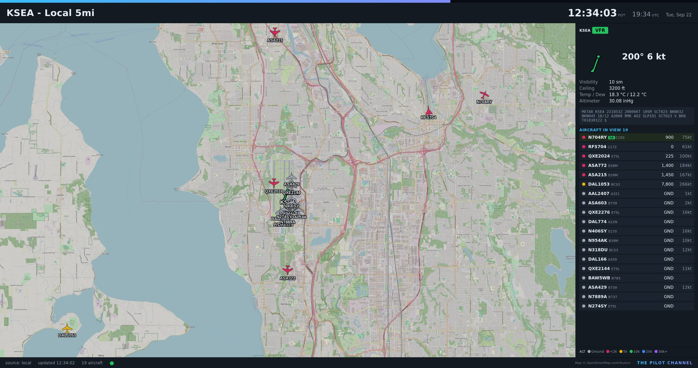
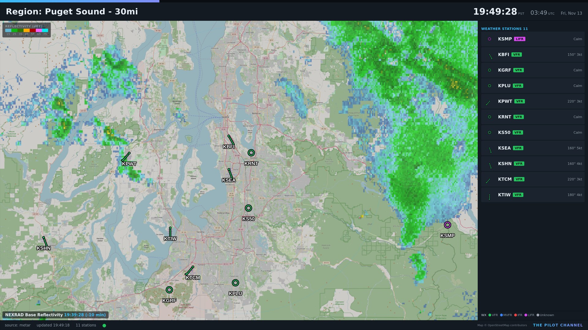
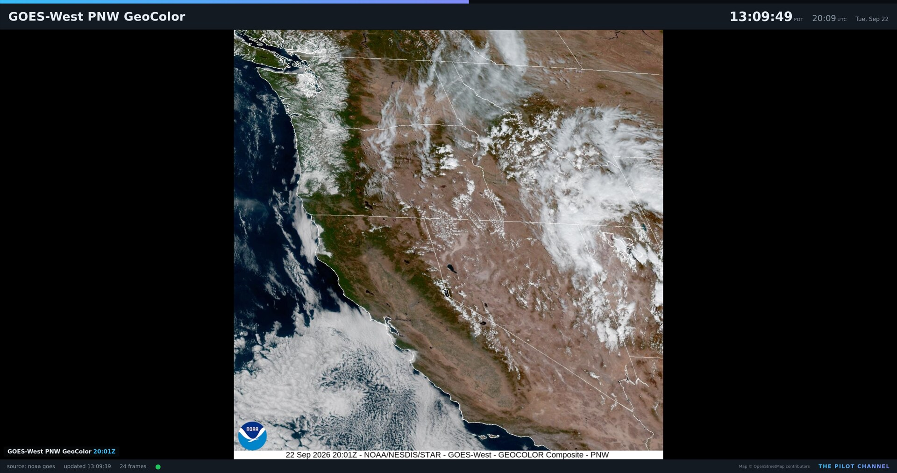
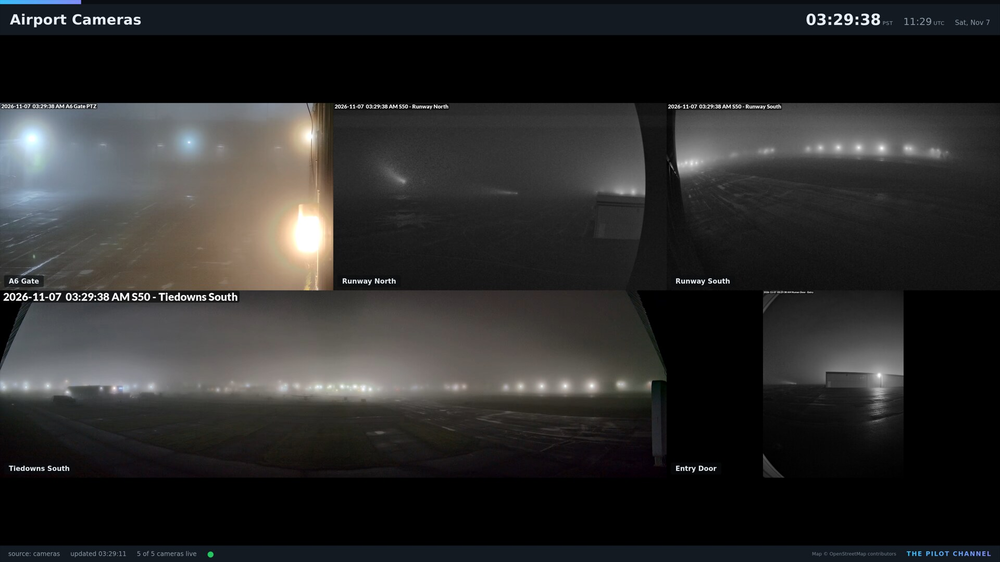
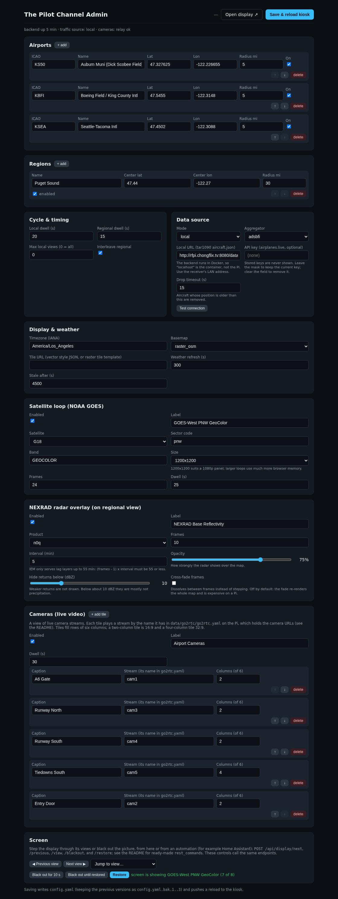

# The Pilot Channel

A wall-mounted information display for an airplane hangar. A Raspberry Pi 5 or 4 drives an
HDMI TV that cycles through live ADS-B air traffic around your airports, METAR weather with
flight-category wind barbs, an animated NEXRAD precipitation radar loop, a NOAA GOES
satellite loop, live video from your security cameras, and local and UTC clocks. Everything
is configured from a phone or laptop on the hangar Wi-Fi.

Local airport view (live traffic, METAR, and wind barb):



Regional weather view (wind barbs for every reporting airport in view, over the radar loop):



Satellite loop view (animated NOAA GOES imagery):



Camera view (live video from UniFi Protect cameras):



Admin page (remote configuration):



## What it shows

The display cycles through views automatically. A bar across the top drains to show the
time left on the current view.

- **Local view, one per airport.** Centered on the airport with a radius you choose (5
  miles is typical). Live aircraft are drawn with tar1090's aircraft icons, chosen the same
  way tar1090 does (by aircraft type, then type class and weight, then the broadcast
  category), colored by altitude and rotated to their track, each labeled with its callsign
  or registration.
  Aircraft on the ground are included. The side panel shows the airport's METAR, decoded
  and raw, with a large wind barb, and a list of every aircraft in view with general
  aviation first.
- **Regional view.** Weather only: a wind barb for every airport reporting a METAR inside
  the map, colored by flight category (VFR green, MVFR blue, IFR red, LIFR magenta), over
  an animated NEXRAD base-reflectivity radar loop. The side panel lists the stations, worst
  conditions first.
- **Satellite loop (optional).** A full-screen NOAA GOES animation for your part of the
  country, for example GOES-West, Pacific Northwest sector, GeoColor.
- **Cameras (optional).** Live video from your security cameras on a grid you arrange: each
  tile plays one stream at the camera's own shape, so a panoramic camera gets a wide tile and
  a portrait camera a tall one. Built for UniFi Protect cameras, whose H.265 streams the Pi 5
  decodes in hardware; the streams are read by go2rtc, so other RTSP cameras it supports can
  be used the same way.

No API keys are needed. Weather comes from the US National Weather Service Aviation Weather
Center, radar from the Iowa Environmental Mesonet, satellite imagery from NOAA STAR, and map
tiles from OpenStreetMap. Traffic comes from your own ADS-B receiver if you have one, or
from a free public aggregator (adsb.fi, adsb.lol, or airplanes.live).

## What you need

- A Raspberry Pi 5 or Pi 4 with 4 GB of memory (it was built on the Pi 4 and runs on the
  Pi 5), a microSD card of 8 GB or more, a power supply, and an HDMI cable to the TV (use
  the HDMI0 port).
- Raspberry Pi OS Lite, 64-bit (the current Debian 13 based release).
- Network access, wired or Wi-Fi. The Pi needs the internet for map tiles, weather, radar,
  and satellite imagery, and for traffic unless you run your own receiver.
- Optional: a tar1090, readsb, or dump1090 receiver on your network for local traffic with
  no rate limits.
- Optional, for the camera view: a Raspberry Pi 5 (the view uses its hardware H.265
  decoder) and cameras with RTSP streams, for example UniFi Protect cameras with RTSP
  turned on.
- A phone or laptop on the same network to configure it.

## Install on the Raspberry Pi

One script turns a freshly flashed Pi into the kiosk. It is safe to run again at any time,
and `--check` reports what is and is not set up without changing anything.

1. **Flash the OS.** Use Raspberry Pi Imager to write Raspberry Pi OS Lite (64-bit). In the
   Imager settings (gear icon) set a hostname, enable SSH, create your user, and enter your
   Wi-Fi details if you are not using Ethernet.

2. **Boot the Pi and connect over SSH** (or plug in a keyboard) as the user you created.

3. **Run the bootstrap.** Pick an admin password so that only you can change the display
   (leave the option off if you really want it open to everyone on your network):

   ```bash
   curl -fsSL https://raw.githubusercontent.com/juchong/ThePilotChannel/main/deploy/bootstrap.sh \
     | bash -s -- --admin-password 'choose-a-password' --reboot
   ```

   It takes ten to twenty minutes, most of it the system update and the first
   build of the app. With `--reboot` the Pi restarts by itself when done; otherwise run
   `sudo reboot`. The TV shows a "The Pilot Channel" holding screen while the app starts,
   then the display.

4. **Check that it worked.** From your phone or laptop open `http://<pi-ip>:8000/admin`
   (the bootstrap prints the address). On the Pi, `~/ThePilotChannel/deploy/bootstrap.sh --check`
   should report every step as `[ok]`.

What the bootstrap does, in order, each step only if it is not already done:

- Updates the system (`apt-get full-upgrade`; skip with `--no-upgrade`).
- Installs the kiosk browser and its compositor (`chromium`, `cage`, `wlrctl`, `seatd`),
  `grim` and ImageMagick for screenshots, `git`, `curl`, and the two packages rootless
  Docker needs (`uidmap`, `dbus-user-session`). The browser is Raspberry Pi's own build of
  Chromium from the Raspberry Pi OS archive; on a Pi 4 it updates with the OS.
- On a Pi 5, replaces that Chromium with the same version patched for the Pi's hardware
  H.265 decoder (the [chromium-rpi-hevc](https://github.com/sslivins/chromium-rpi-hevc)
  build, downloaded from its release and checked against the published checksums) and holds
  the packages so OS updates keep it. The camera view needs it; nothing else does.
- Clones this repository to `~/ThePilotChannel` (or uses the clone it is run from).
- Installs a small wrapper from the clone so `grim` can write `jpeg`, `webp`, `avif`, and
  `gif` screenshots (the stock Debian build only writes `png`);
  `sudo rm /usr/local/bin/grim` reverts to the stock grim.
- Protects the Wi-Fi settings from power cuts (`deploy/harden-wifi.sh`). Raspberry Pi OS
  keeps the Wi-Fi details from Imager in files it rewrites at every boot, and a power cut
  during boot can leave them empty. The bootstrap moves them into a regular NetworkManager
  profile with a read-only backup copy and stops cloud-init from restoring the old files.
- Installs Docker CE with Docker's own installer, then switches it to rootless mode for
  your user: the daemon runs as you, not root, starts at boot without a login (waiting for
  the network's DNS first), and the root-level daemon is disabled so it does not waste
  memory.
- Enables the GPU overlay (`dtoverlay=vc4-kms-v3d`, `max_framebuffers=2`) the kiosk needs.
- Enables `seatd` and puts your user in the `video`, `render`, and `input` groups so the
  kiosk can drive the HDMI output directly.
- Configures automatic login on the TV console (tty1) and adds a hook to your login shell
  that starts the kiosk there and nowhere else (not over SSH).
- Turns Wi-Fi power saving off, which otherwise drops connections on an unattended Pi.
- Keeps the system log across reboots, capped at 64 MB, so a crash or a dropped network
  link leaves evidence (`journalctl -b -1` shows the previous boot).
- Writes the admin password to `.env` if you gave one.
- Builds the app image and starts it, waiting until it answers.

Options: `--check`, `--dry-run`, `--no-upgrade`, `--no-start`, `--reboot`,
`--admin-password PW`, `--repo-dir DIR`. Run it with `--help` for the same list.

The kiosk runs natively (cage plus Chromium) rather than in Docker because it needs the
GPU and HDMI output. It keeps Chromium's profile, cache, and its log on a RAM disk
(`/dev/shm/hangar-kiosk`) to spare the SD card.

## Try it without a Pi

You can run the app on any 64-bit Linux machine with Docker and look at it in a browser.
This is handy for setting up airports before the Pi is ready.

```bash
curl -fsSL https://get.docker.com | sudo sh
sudo usermod -aG docker "$USER"   # log out and back in afterwards
git clone https://github.com/juchong/ThePilotChannel.git
cd ThePilotChannel
docker compose up -d --build
```

Then open `http://<host-ip>:8000` for the display and `http://<host-ip>:8000/admin` for the
settings.

## Set up your hangar

Open `http://<pi-ip>:8000/admin` (it asks for the password if you set one). Every field is
checked when you save, mistakes are highlighted, and the TV reloads with the new settings.

**Airports.** One row per airport you want a local view for: the ICAO identifier (for
example `KSEA`; for US fields without one use the FAA identifier such as `S50`), a name, the
latitude and longitude of the field, and the radius in miles. Use the arrows to set the
order they appear in. Airports without a weather station show "no weather" on their local
view but still show traffic.

**Regions.** A wider view for the weather overview: a center point and a radius. Wind
barbs appear for every airport reporting weather inside the map, not just the ones you
listed. One region is usually enough; with more, they are interleaved between the local
views.

**Cycle and timing.** How many seconds each local and regional view stays on screen.

**Data source.** Where aircraft positions come from:

- `aggregator`: a free public feed. Pick adsb.fi, adsb.lol, or airplanes.live. Coverage
  depends on volunteers' receivers near your airport, and updates arrive about once a
  second.
- `local`: your own tar1090, readsb, or dump1090 receiver. Enter the URL of its
  `aircraft.json`, for example `http://192.168.1.20:8080/data/aircraft.json`. Use the
  receiver's LAN address even if it runs on the Pi itself, because the app runs inside a
  container where `localhost` means the container.
- `auto`: use the local receiver and fall back to the aggregator when it is unreachable.

Press **Test connection** to check the source before saving; it reports how many aircraft
each source sees near your first airport.

**Display.** Your IANA timezone (for example `America/Denver`) for the clock. The map
uses OpenStreetMap tiles by default. The Pi keeps a copy of every tile your views need in
`data/tiles` (fetched once, refreshed every two weeks) and downloads them for new airports
and regions in the background after you save, so views switch without the map redrawing.
If you have your own tile server or a vector style URL from a map provider, enter it here.

**Weather.** How often METARs refresh and when to flag a report as stale.

**Satellite loop.** Choose the satellite (G16 is GOES-East, G18 is GOES-West), the sector,
and the band. Find your sector code on the NOAA STAR GOES image viewer: open your region's
page and use the short code from its address, for example `pnw` (Pacific Northwest),
`psw` (Pacific Southwest), `nr` (Northern Rockies), `sr` (Southern Rockies), `sp`
(Southern Plains), `umv` (Upper Mississippi Valley), `cgl` (Central Great Lakes), `ne`
(Northeast), `se` (Southeast). `GEOCOLOR` is the natural-color band most people want.
`1200x1200` frames suit a 1080p TV.

**Radar overlay.** Shown on the regional view. Ten frames five minutes apart give a
45-minute loop; the loop can reach back at most 55 minutes. The opacity slider sets how
strongly the radar shows over the map. "Hide returns below" leaves out weak returns, which
below about 10 dBZ are mostly not precipitation; set it to 0 to draw everything the radar
sees. Frames step every half second.
"Cross-fade frames" dissolves them into each other instead; it is off by default because
the fade is expensive on a Pi 4.

**Cameras.** Live video from your security cameras. The stream links are not entered on the
admin page: they carry access tokens, so they live in a file on the Pi that is never
committed, `data/go2rtc/go2rtc.yaml`, read by the go2rtc relay that runs beside the app.
One line per camera, with the name you will refer to it by:

```yaml
streams:
  gate: rtsps://192.168.1.1:7441/AbCdEfGhIjKlMnOp
  runway: rtsps://192.168.1.1:7441/QrStUvWxYz012345
```

For UniFi Protect, open the camera's settings, Advanced, turn on RTSP for the quality you
want and copy the link. Use the medium quality: a tile is at most 1280 pixels wide on a 4K
TV, and several cameras' full-resolution streams are more than the Pi's decoder is rated
for. Leave off the `?enableSrtp` that Protect appends to the link: go2rtc does not decrypt
SRTP, and the link is already carried inside TLS without it. After editing the file run
`docker compose restart go2rtc`.

Then enable the view on the admin page and add a tile per camera: a caption, the stream's
name from the file, and how many of the six grid columns it spans. Every row is as tall as a
16:9 two-column tile, so two columns suit a normal camera and four a panoramic one; a
portrait camera is centered in its tile. Tiles fill the rows in order. The status line at
the top of the admin page says whether the relay is up and names tiles whose stream it does
not know.

**Screen.** Buttons to step the display to the previous or next view or jump to one, and
to black out and restore the picture: the same things an automation can do (see below).

### Editing the file directly

Everything the admin page sets lives in `data/config.yaml` on the Pi. You can edit it by
hand and run `docker compose restart` to apply. The previous three versions are kept as
`config.yaml.bak.1` to `.3` every time it is saved, and if the file is ever unreadable the
display still starts, using the newest good backup, and the admin page shows a banner
explaining what is wrong.

```yaml
airports:
  - icao: KSEA
    name: Seattle-Tacoma Intl
    lat: 47.4502
    lon: -122.3088
    local_radius_mi: 5.0
    enabled: true

regions:
  - name: Puget Sound
    center_lat: 47.44
    center_lon: -122.27
    radius_mi: 30.0
    enabled: true

cycle:
  local_dwell_s: 20          # seconds on each local view
  regional_dwell_s: 15       # seconds on each regional view
  order: []                  # optional explicit order of view ids
  max_local_views: 0         # 0 means show every enabled airport
  interleave_regional: true  # put a regional view between local views

data_source:
  mode: auto                 # local | aggregator | auto
  local_url: http://192.168.1.20:8080/data/aircraft.json
  aggregator: adsbfi         # adsbfi | adsblol | airplaneslive
  api_key: ""                # airplanes.live Pro only; never shown again once saved
  drop_timeout_s: 15         # remove an aircraft whose position is older than this

display:
  timezone: America/Los_Angeles
  basemap: raster_osm        # raster_osm | vector
  tile_url: ""               # vector style URL, or a raster tile template override

weather:
  refresh_s: 300
  stale_after_s: 4500

satellite:
  enabled: true
  sat: G18                   # G16 (East), G18 (West), G19
  sector: pnw
  band: GEOCOLOR
  frames: 24
  size: 1200x1200            # 300x300 | 600x600 | 1200x1200 | 2400x2400
  dwell_s: 25
  label: GOES-West PNW GeoColor

radar:
  enabled: true
  label: NEXRAD Base Reflectivity
  frames: 10
  interval_min: 5            # multiple of 5; (frames - 1) x interval must be 55 or less
  opacity: 0.75              # 0 (invisible) to 1 (solid)
  min_dbz: 10                # hide returns weaker than this (dBZ)
  product: n0q               # n0q (base reflectivity) | n0r
  crossfade: false           # dissolve between frames (expensive on a Pi 4)

cameras:
  enabled: false
  label: Cameras
  dwell_s: 30
  tiles:                     # streams by their name in data/go2rtc/go2rtc.yaml
    - name: Gate             # caption; the stream name when empty
      stream: gate
      cols: 2                # of 6 grid columns: 2 is a 16:9 tile, 4 a 32:9 tile
```

## Control the screen from an automation

Home Assistant or any other system on the network can step the display through its views,
jump to a view, and black out the picture. The admin page's Screen section has buttons for
the same things.

### Change the view

The display keeps cycling on its own; these calls move it on, back, or straight to a view,
which then stays up for its usual time before the cycle continues. Add `-u any:<password>`
if you set an admin password.

```bash
curl -X POST http://<pi-ip>:8000/api/display/next
```

```bash
curl -X POST http://<pi-ip>:8000/api/display/previous
```

```bash
# jump to a view by id; GET /api/views lists them (local:KSEA, region:Puget Sound, satellite, cameras)
curl -X POST -H 'content-type: application/json' \
  -d '{"view": "satellite"}' http://<pi-ip>:8000/api/display/view
```

`GET /api/display` reports what is on screen: `showing.label`, and its place in the cycle as
`showing.index` of `showing.count`. Reading it needs no password.

Home Assistant, in `configuration.yaml` (drop the `username` and `password` lines if there
is no admin password): commands for the buttons and for jumping to a view, and a sensor
that shows the current view.

```yaml
rest_command:
  hangar_display_next:
    url: "http://<pi-ip>:8000/api/display/next"
    method: post
    username: hass
    password: !secret hangar_admin_password
  hangar_display_previous:
    url: "http://<pi-ip>:8000/api/display/previous"
    method: post
    username: hass
    password: !secret hangar_admin_password
  hangar_display_view:
    url: "http://<pi-ip>:8000/api/display/view"
    method: post
    content_type: "application/json"
    username: hass
    password: !secret hangar_admin_password
    payload: '{"view": "{{ view }}"}'

rest:
  - resource: "http://<pi-ip>:8000/api/display"
    scan_interval: 5
    sensor:
      - name: Hangar display view
        value_template: "{{ value_json.showing.label or 'unknown' }}"
```

On a dashboard, previous and next buttons around the current view:

```yaml
type: horizontal-stack
cards:
  - type: button
    name: Previous
    icon: mdi:skip-previous
    tap_action:
      action: perform-action
      perform_action: rest_command.hangar_display_previous
  - type: entity
    entity: sensor.hangar_display_view
    name: Showing
  - type: button
    name: Next
    icon: mdi:skip-next
    tap_action:
      action: perform-action
      perform_action: rest_command.hangar_display_next
```

To jump to a view from an automation or a script, pass its id:

```yaml
actions:
  - action: rest_command.hangar_display_view
    data:
      view: satellite
```

A dashboard button that brings up the cameras:

```yaml
type: button
name: Cameras
icon: mdi:cctv
tap_action:
  action: perform-action
  perform_action: rest_command.hangar_display_view
  data:
    view: cameras
```

### Black out the picture

The TV picture can be blacked out for a while and brought back, for example while a movie
plays or when a doorbell rings. The display keeps running underneath, so the picture
returns instantly.

```bash
# black out for 30 seconds
curl -X POST -H 'content-type: application/json' \
  -d '{"seconds": 30, "reason": "doorbell"}' http://<pi-ip>:8000/api/display/blackout
```

```bash
# black out until told otherwise, then restore
curl -X POST http://<pi-ip>:8000/api/display/blackout
curl -X POST http://<pi-ip>:8000/api/display/restore
```

Add `-u any:<password>` to those calls if you set an admin password.

Home Assistant, in `configuration.yaml` (drop the `username` and `password` lines if there
is no admin password):

```yaml
rest_command:
  hangar_display_blackout:
    url: "http://<pi-ip>:8000/api/display/blackout"
    method: post
    content_type: "application/json"
    username: hass
    password: !secret hangar_admin_password
    payload: '{"seconds": {{ seconds | default(30) }}, "reason": "{{ reason | default("home assistant") }}"}'
  hangar_display_restore:
    url: "http://<pi-ip>:8000/api/display/restore"
    method: post
    username: hass
    password: !secret hangar_admin_password
```

Then in an automation:

```yaml
actions:
  - action: rest_command.hangar_display_blackout
    data:
      seconds: 20
      reason: doorbell
```

## Day to day

- **Change settings:** use the admin page. The TV reloads itself when you save.
- **Update to a new version:**

  ```bash
  cd ThePilotChannel && git pull && docker compose up -d --build
  ```

  The display notices the new version and reloads on its own.
- **Update the OS:** `sudo apt full-upgrade` and reboot, or run the bootstrap again (it
  upgrades the system and re-checks every other step). On a Pi 4 the kiosk browser updates
  with the OS; on a Pi 5 it is held at the patched build, and a newer patched release is
  taken up by changing the release named in `deploy/bootstrap.sh` and running it again.
- **Add or change a camera:** edit `data/go2rtc/go2rtc.yaml` and run
  `docker compose restart go2rtc`; the tiles are arranged on the admin page.
- **Restart the display browser:** `pkill -x cage`. It comes straight back.
- **Reboot the Pi:** everything starts again automatically, including after a power cut.
- **Move to a new Pi:** your settings are the file `data/config.yaml` in the clone (the admin
  page writes them there), so copy it off the old Pi, or commit it in your clone, before
  retiring it. Flash and bootstrap the new Pi as in the install steps, put the file back under
  `data/`, and run `docker compose restart`. The tile and weather caches rebuild on their
  own. The new Pi may get a different address: update any automation that points at it.
- **Change the Wi-Fi network or password:** use `sudo nmtui` (Edit a connection), then run
  `sudo ~/ThePilotChannel/deploy/harden-wifi.sh`: it moves the edited profile back out of
  netplan and refreshes the backup copy. To forget a network, delete it in `nmtui` and
  remove its `hardened-<uuid>.nmconnection` file from
  `/usr/lib/NetworkManager/system-connections`.
- **Logs:** the app's log is `docker compose logs -f` (capped so it cannot fill the SD
  card), the camera relay's `docker compose logs go2rtc`; the kiosk browser's log is
  `/dev/shm/hangar-kiosk/hangar-kiosk.log`.
- **Undo a bad config change:** copy `data/config.yaml.bak.1` over `data/config.yaml` and
  run `docker compose restart`.
- **Map looks out of date or oddly cached:** delete the `data/tiles` folder; it is rebuilt
  automatically.

## Troubleshooting

- **The Pi does not come back on Wi-Fi after a power cut.** Plug in a network cable
  (Ethernet needs no saved settings) or a keyboard, then run
  `sudo ~/ThePilotChannel/deploy/harden-wifi.sh`. It recreates the Wi-Fi profile from the
  details you entered in Imager (kept in `/boot/firmware/network-config`) and removes the
  emptied files in `/etc/netplan`. `deploy/harden-wifi.sh --check` shows whether a Pi is
  protected; the cause is a
  [Raspberry Pi OS issue](https://github.com/raspberrypi/trixie-feedback/issues/99).
- **The TV stays black or shows only the holding screen.** The app is not up yet or failed
  to start: run `docker compose ps` and `docker compose logs --tail=50` on the Pi. If the
  kiosk never appears at all, check `/dev/shm/hangar-kiosk/hangar-kiosk.log`, confirm
  `dtoverlay=vc4-kms-v3d` is in `/boot/firmware/config.txt`, and make sure you rebooted
  after the installer.
- **`Unable to create the wlroots backend` in the kiosk log.** The kiosk must start from
  the physical console (tty1) with no `WAYLAND_DISPLAY` in its environment. Do not export
  `WAYLAND_DISPLAY` in your login shell.
- **`docker` commands fail or say the daemon is not running.** Docker runs in rootless
  mode as your user: run `docker` commands as that user without `sudo`, and check
  `systemctl --user status docker`. `deploy/bootstrap.sh --check` reports what is wrong.
- **Every view waits for data after a reboot, and the weather is missing.** The app
  container started before the Wi-Fi link had a DNS server and cannot resolve names;
  `/api/status` shows "Temporary failure in name resolution". Run
  `systemctl --user restart docker` and it recovers at once. The bootstrap makes the daemon
  wait for DNS at boot; `deploy/bootstrap.sh --check` confirms that is in place.
- **No aircraft.** Open `http://<pi-ip>:8000/api/status` or press Test connection on the
  admin page. For a local receiver, the URL must be its LAN address, not `localhost`.
- **No weather or wind barbs.** Check that the Pi can reach `aviationweather.gov` and that
  the identifier is right; some small fields have no weather station, and a newly installed
  AWOS shows up only once aviationweather.gov lists it. The display keeps the last weather
  it fetched, also across restarts, and turns the footer dot amber when it is getting old
  and red when refreshes are failing. `docker compose logs` shows the error; a
  name-resolution error means the router's DNS is not answering.
- **Map tiles do not load.** The Pi cannot reach OpenStreetMap. Check connectivity; tiles
  already in `data/tiles` keep working meanwhile. Or point `tile_url` at your own tile
  server.
- **A red banner on the admin page about `config.yaml`.** The file could not be read; the
  display is running with a backup or defaults. Fix the file by hand, or save from the admin
  page to write a fresh one (the broken file is kept as `config.yaml.bak.1`).
- **The footer dot is amber or red.** Amber means the last traffic snapshot is more than
  ten seconds old; red means the source is failing. Hover over it in a browser, or check
  `/api/status`, for the reason.
- **A camera tile says NO SIGNAL.** The relay is not getting that stream. The admin page's
  status line says whether the relay is up and lists tile streams it does not know (the
  name must match one in `data/go2rtc/go2rtc.yaml`), and `docker compose logs go2rtc` shows
  why a camera does not connect. A Protect link must be used without its `?enableSrtp`
  suffix, and the camera's RTSP output must be turned on.
- **Camera video is choppy, or the tiles stay black on a Pi 4.** The camera view needs the
  Pi 5's hardware decoder. On a Pi 5, `deploy/bootstrap.sh --check` confirms that the
  patched browser is installed and held.

## Credits and licenses

- Aircraft icons and their assignment tables are from [tar1090](https://github.com/wiedehopf/tar1090)
  (GPL-2.0, based on FlightAware's dump1090; the C-130 icon is by Peter Lowden, CC BY 4.0).
  They are vendored under `frontend/src/lib/vendor/tar1090/` with tar1090's license.
- The aircraft type table (ICAO type designator to type description and wake category) is
  from [tar1090-db](https://github.com/wiedehopf/tar1090-db).
- Map data © OpenStreetMap contributors. Weather from the NWS Aviation Weather Center,
  radar from the Iowa Environmental Mesonet, satellite imagery from NOAA STAR.
- Camera streams are relayed by [go2rtc](https://github.com/AlexxIT/go2rtc) (MIT), run as
  its own container. Hardware H.265 decoding in the kiosk browser comes from the
  [chromium-rpi-hevc](https://github.com/sslivins/chromium-rpi-hevc) build of Raspberry Pi
  OS's Chromium.

## License

The Pilot Channel is free software: you can redistribute it and modify it under the terms
of the GNU General Public License, version 2, as published by the Free Software Foundation.
See [LICENSE](LICENSE). It is distributed in the hope that it will be useful, but without
any warranty. Copyright (C) 2026 Juan J Chong.

## For developers and AI agents

Architecture, code conventions, invariants, and the build, test, and verify workflow are in
[AGENTS.md](AGENTS.md).
